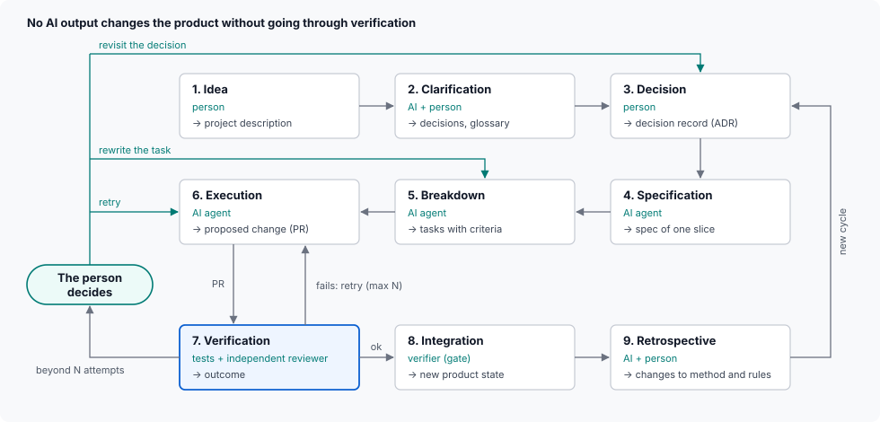
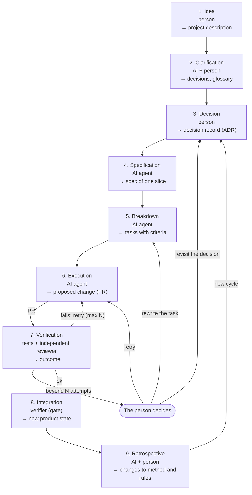

# MB. Base method

A generic starting point, to adapt to each project. Every step is a node with its own card (`MM-4`).

## MB-1 Three execution levels

Each step of the method is assigned to the lowest level that is enough: what a script can do is not done by an AI; what an AI with a verifier can do is not done by a person.

| Level | Node type (N3) | Determinism (N10) | Examples | Verification |
| --- | --- | --- | --- | --- |
| Mechanical | Tool, automatic verifier | Yes | Create a branch or a working folder, run the checks, push, open a PR, read the outcome of a run, the Integration gate, clean-up | The script's own tests |
| Judgement | AI agent, AI reviewer | No | Specify, break down, implement, review, propose the retrospective | A verifier downstream (`P3`) |
| Decision | Person | No | Choose, approve a constraint or a protected file, decide beyond the attempt budget | The end of the chain (`P3`, `CC-16`) |

## MB-2 Steps

No AI output changes the product without going through verification.

The drawing above is a hand-made SVG (`diagrams/mb-2.svg`), because Mermaid cannot lay out a snake grid with its return edges. The textual source, which agents read and change, is the Mermaid below: if a step changes, both are updated.

| # | Step | Executor | Level (`MB-1`) | Output |
| --- | --- | --- | --- | --- |
| 1 | Idea | Person | Decision | Project description |
| 2 | Clarification | AI + person | Judgement + decision | Decisions, glossary |
| 3 | Decision | Person | Decision | Decision record (ADR) |
| 4 | Specification | AI agent | Judgement | Spec of one slice |
| 5 | Breakdown | AI agent | Judgement | Tasks with criteria |
| 6 | Execution | AI agent | Judgement | Proposed change (PR) |
| 7 | Verification | Tests + independent reviewer | Mechanical + judgement | Outcome |
| 8 | Integration | Verifier (gate) | Mechanical | New product state |
| 9 | Retrospective | AI + person | Judgement + decision | Changes to method and rules |

The tools that carry out each step come from the adopted toolkit template (`TK`).

## MB-3 Cycles

Return edges are what make a method different from a pipeline:

- verification sends the work back to execution at most N times; beyond N the person decides (`P7`) between three paths: retry (back to Execution with more attempts), rewrite the task (back to Breakdown) or revisit the decision (back to Decision);
- the retrospective opens a new cycle from Decision: it changes decisions, rules and checks, going through `P6`;
- a contradiction found at any step goes back to Decision.

## MB-4 The person as a node

The person is a node like the others, with a card. What sets it apart:

- **Input**: arrives only in a form ready for a decision: a question with a recommendation, a report with the evidence, a diff to approve.
- **Output**: a written decision (`P9`), which the method records.
- **Mandatory decision points**: steps 1, 2, 3 and 9 of `MB-2`, the choice beyond N attempts in `MB-3`, and every change to constraints, protected files and cards in the protected area (`MB-6`). Other points, such as a review by the person during Verification or an approval before Integration, are added per project.
- **Interruption budget**: set per project, from the questions in `PA-3` or from a `TP` template. Parameters: how many interruptions per day, in which time windows, on which channel, what is queued and what interrupts at once.

## MB-5 The engine

The engine is the node that runs the method: it calls the tools, starts the agents, stops at the decision points and delivers questions to the person. It has a card like any other node, with these parts:

| Part | What it declares |
| --- | --- |
| Controller | Where it runs; how it reads the state and chooses the next step; with which permissions |
| Method state | Where tasks, cards and decisions live; who writes it (`P13`) |
| Compute resources | N resources, N to be decided. For each: type (local, online), environment, capabilities (models, tools), permissions, cost, availability |
| Channel to the person | How questions and reports arrive; how decisions come back (`MB-4`) |
| Stopping | How you stop it, who can, what happens to work in progress (`CC-18`) |
| Measures | Duration, cost, attempts, interruptions (`P10`) |

Each part is decided per project, from the questions in `PA-3` or starting from a `TM` template. The same schema covers an engine running entirely on one computer, entirely on one server, or spread over several servers and computers.

## MB-6 Protected area of the method

The method also describes itself. An agent that can change the method's cards can change its own rules, so those cards, the constraints and the protected files live in a protected area: they change only by a decision of the person (`CC-7`), enforced mechanically whenever possible (`P4`).

Links between product and method:

- the state the method works on is the product itself: code, cards, documents;
- the agents' skills and prompts implement the method's nodes, as code implements the product's nodes.
