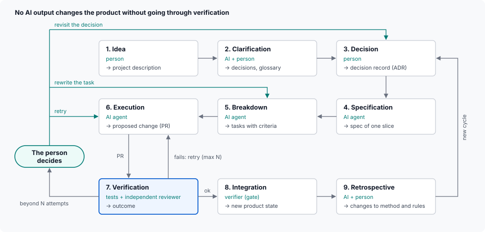
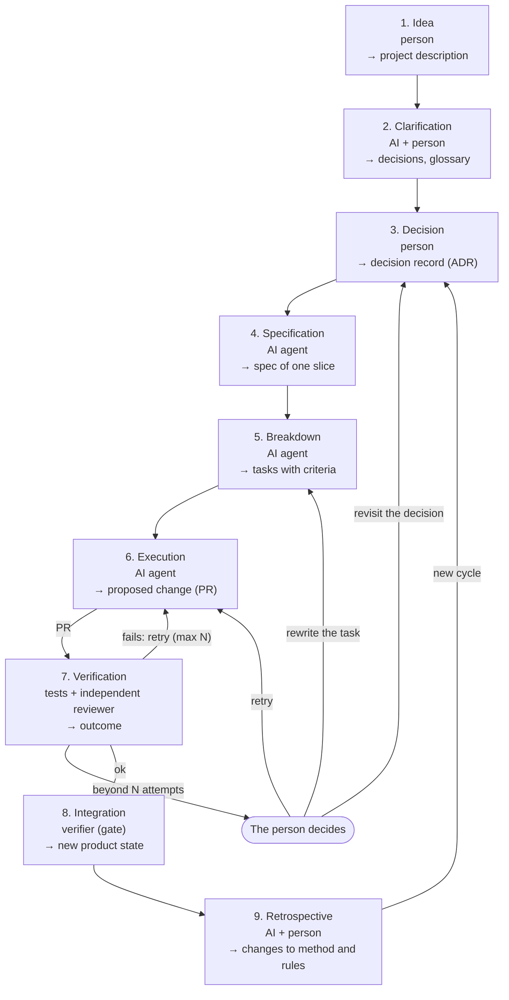

## MB-2 Steps

No AI output changes the product without going through verification.

The drawing above is a hand-made SVG (`diagrams/mb-2.svg`), because Mermaid cannot lay out a snake grid with its return edges. The textual source, which agents read and change, is the Mermaid below: if a step changes, both are updated.

| # | Step | Executor | Level (`MB-1`) | Output |
| --- | --- | --- | --- | --- |
| 1 | Idea | Person | Decision | Project description |
| 2 | Clarification | AI + person | Judgement + decision | Decisions, glossary |
| 3 | Decision | Person | Decision | Decision record (ADR) |
| 4 | Specification | AI agent | Judgement | Spec of one slice |
| 5 | Breakdown | AI agent | Judgement | Tasks with criteria |
| 6 | Execution | AI agent | Judgement | Proposed change (PR) |
| 7 | Verification | Tests + independent reviewer | Mechanical + judgement | Outcome |
| 8 | Integration | Verifier (gate) | Mechanical | New product state |
| 9 | Retrospective | AI + person | Judgement + decision | Changes to method and rules |

The tools that carry out each step come from the adopted toolkit template (`TK`).
