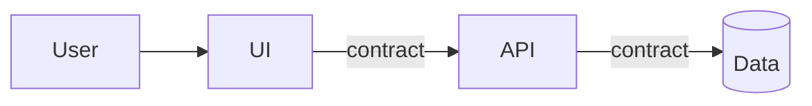
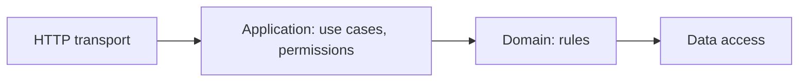

# TA-1 Multi-user client-server application

When to use it: several users, shared data, access from a browser or an app, different permissions per role.

The way back (data → API → UI) is not a separate flow: it is the response on the same edges.

Boundaries:

| Boundary | Contains | Trust | Rule |
| --- | --- | --- | --- |
| Client | UI | None: it runs on the user's machine | Holds no secrets and no security rules that matter |
| Server | API, domain logic | Yes | The only place that checks identity and permissions (`P12`) |
| Data | Database, files | Yes, narrower | Reachable only from the API, never from the outside network (`P11`, `P13`) |

Edges:

| Edge | Contract | Security |
| --- | --- | --- |
| UI → API | Published, versioned contract (e.g. OpenAPI) | Encrypted channel; identity via session or token; permissions and validation in the API; CSRF defences if cookies are used |
| API → data | Versioned schema, changed only through migrations | Credentials with minimal permissions; no query built from user text |

Zoom inside the API, so that logic does not end up in the entry points:

Dependencies go only in that direction; the domain knows neither HTTP nor the database.

Constraints and how they are enforced:

| Constraint | How it is enforced |
| --- | --- |
| The UI depends neither on data nor on the domain | Architecture test in the pipeline; separate repos or packages |
| The domain depends neither on transport nor on data access | Architecture test in the pipeline |
| The database is not reachable from outside | Network configuration of the environment; check at start-up |
| Every endpoint declares the permission it requires | A test that lists the endpoints and fails those without a permission |
| Configuration and secrets stay out of the code | Secret scanning in the pipeline; start-up fails if variables are missing |
| The schema changes only through migrations | Pipeline check: generated schema equals the migrations' schema |

Quality goals to set for the project, in the form of `MM-5`: concurrent users per customer, response time, availability, time to restore from backup, data separation between customers.
